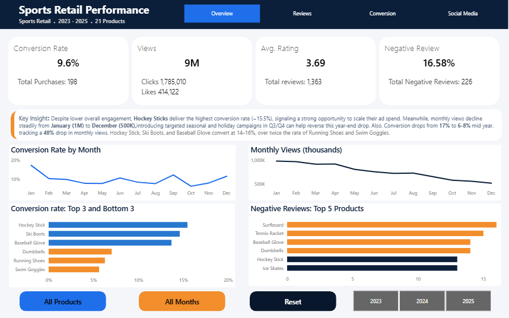
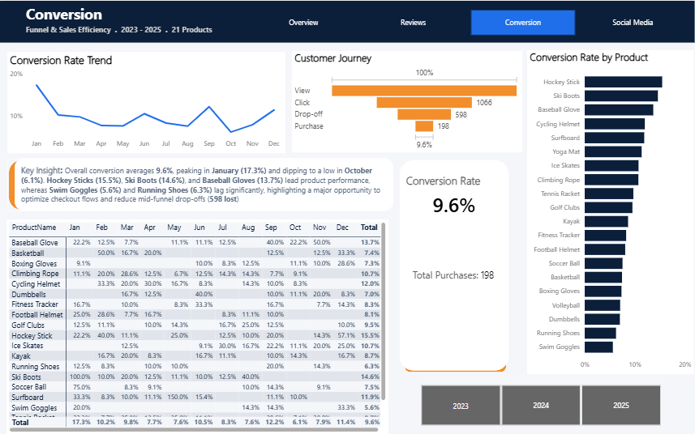
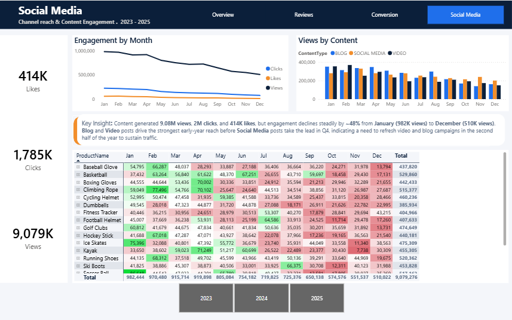
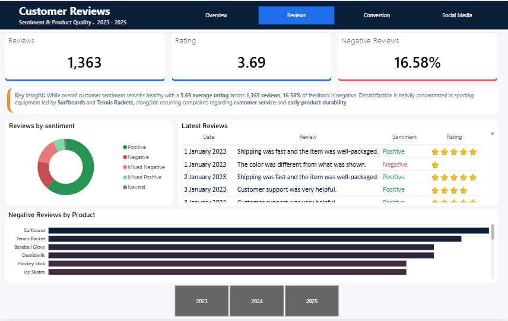

# Sports Retail Performance Dashboard

An interactive four-page Power BI dashboard analyzing conversion, social media engagement, and customer reviews across 21 sports products from 2023 to 2025.



## Business Questions

- Which products convert best, and where do customers drop off in the funnel?
- How does engagement (views, clicks, likes) change over the year, and which content types drive it?
- Which products generate the most negative reviews, and what are customers complaining about?

## Key Findings

- **Conversion averages 9.6%** (198 purchases from 2,070 views), falling from 17.3% in January to 6.1% in October.
- **Views dropped 48%** from January (982K) to December (510K), tracking the decline in conversion.
- **Hockey Stick (15.5%), Ski Boots (14.6%), and Baseball Glove (13.7%)** convert at more than twice the rate of Running Shoes (6.3%) and Swim Goggles (5.6%).
- **Funnel:** 2,070 views, 1,066 clicks, 598 drop-offs, 198 purchases. The mid-funnel drop-off is the largest leak.
- **Engagement:** 9.08M views, 1.79M clicks, and 414K likes. Blog and Video lead early-year reach, and Social Media posts lead in Q4.
- **Reviews:** 1,363 reviews with a 3.69 average rating. 16.58% are negative (226), concentrated in Surfboard and Tennis Racket, with recurring complaints about customer service and early product durability.

## Recommendations

1. Shift ad spend toward the highest-converting products (Hockey Stick, Ski Boots, Baseball Glove).
2. Run targeted seasonal and holiday campaigns in Q3 and Q4 to offset the year-end drop in views.
3. Refresh video and blog content in the second half of the year to sustain traffic.
4. Investigate quality and durability issues on the products with the most negative reviews.
5. Review checkout and mid-funnel steps to reduce the 598 drop-offs.

## Dashboard Pages

| Page | Focus | Screenshot |
|---|---|---|
| Overview | Headline KPIs, monthly conversion and views, top and bottom products, top negative-review products |  |
| Conversion | Customer journey funnel, monthly conversion trend, product-by-month conversion matrix |  |
| Social Media | Engagement by month, views by content type (blog, social media, video), views by product and month heatmap |  |
| Customer Reviews | Sentiment breakdown, latest reviews with ratings, negative reviews by product |  |

All pages include year and month filters and page navigation buttons.

## Data Model

Star schema with dimension and fact tables:

| Table | Type | Description |
|---|---|---|
| `dim_customers` | Dimension | Customer attributes |
| `dim_products` | Dimension | Product attributes (21 products) |
| `Calendar` | Dimension | Date table used for year and month filtering |
| `fct_customer_journey` | Fact | Customer actions: view, click, drop-off, purchase |
| `fct_engagement_data` | Fact | Views, clicks, and likes by product, date, and content type |
| `fct_customer_reviews_with_sentiment` | Fact | Review text, rating, and sentiment category |
| `_Measures` | Measures | DAX measures (conversion rate, review metrics, engagement totals) |

## Tools

- Power BI Desktop
- DAX
- Data modeling (star schema)

## Repository Structure

```
.
├── SportsRetailPerformance.pbix   # Power BI dashboard (update to your file name)
├── Screenshots/
│   ├── Overview.png
│   ├── Conversion.png
│   ├── socialMedia.png
│   └── Reviews.png
└── README.md
```

## How to Use

1. Download the `.pbix` file from this repository.
2. Open it in Power BI Desktop.
3. Use the year and month filters, product slicers, and page navigation buttons to explore.


## Author

**Bilal Rizvi**
[GitHub](https://github.com/bilalrizvi21) · [Portfolio](https://www.datascienceportfol.io/bilalrizvi21)
